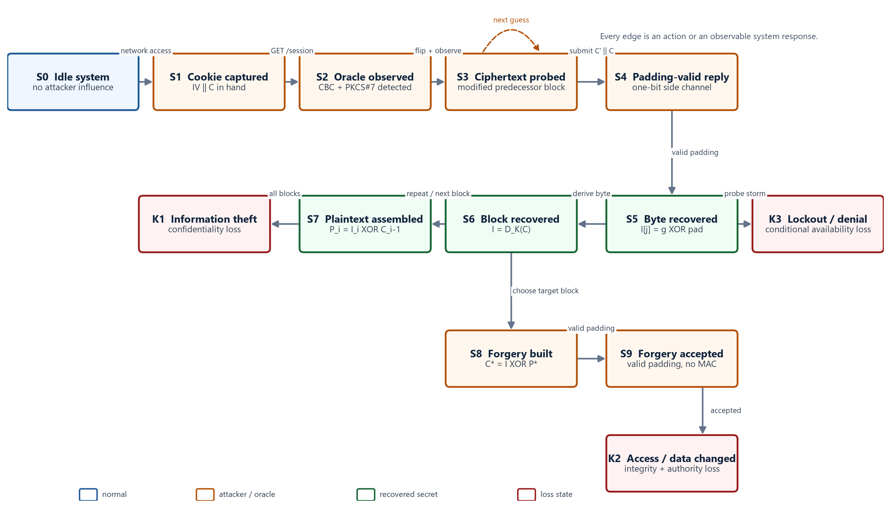

# HDU IS Laboratory - Work 3

- **Repository:** <https://github.com/AlaIchhe/hdu-is-work3-padding-oracle>
- **Topic:** Padding Oracle Attack on AES-CBC
- **Variant:** 3
- **Student:** zhuhe
- **HDU number:** 23320116
- **Date:** 20 October 2026

This repository is a self-contained submission for Laboratory Work 3: Computer Attacks. It contains the report, the public presentation, a reproducible localhost demonstration, and the attack digraph.



> **Security warning**
>
> `lab/app.py` is intentionally vulnerable and exposes a padding oracle. It binds to `127.0.0.1` only and uses synthetic data. Do not deploy it, expose it to a network, or reuse its key or error behavior. The exploit is included solely for authorised security education.

## Deliverables

- [Work 3 report](report/Work3_Padding_Oracle_Report.pdf) - 11-page A4 report with the attack analysis, evidence, digraph, state and transition tables, loss analysis, and countermeasures.
- [Public presentation](slides/Work3_Padding_Oracle_Presentation.pptx) - 12 editable slides with speaker notes.
- [Captured demonstration](evidence/padding-oracle-demo.txt) - reproducible output from the localhost lab.

## Attack summary

AES-CBC provides confidentiality but not ciphertext integrity. For block `i`, decryption computes:

```text
P[i] = D_K(C[i]) xor C[i-1]
```

The application uses PKCS#7 padding and returns a distinct `invalid padding` response. That response is a one-bit oracle: an attacker can change the preceding block, test a candidate byte, and learn whether the resulting padding is valid. Repeating this test for all 16 positions recovers the intermediate block and therefore the plaintext.

For the first block, the predecessor is the IV. Once `I[0] = D_K(C[0])` is known, a chosen plaintext block `P*[0]` can be produced with:

```text
IV* = I[0] xor P*[0]
```

No key byte is recovered. The committed evidence run used 3,707 requests to recover two blocks, then changed `role=user;uid=10` to `role=root;uid=10`. The service accepted the forged cookie and returned the administrative view. Query counts vary between runs because the IV and the search order are randomized; the evidence image records the capture time and the random IV used for this run.

## Attack digraph

The model starts in `S0` and has three terminal loss classes: `K1` information theft, `K2` modification or unauthorised access, and `K3` conditional denial of service or access.

| State | Meaning |
| --- | --- |
| `S0` | Idle system; no attacker influence. |
| `S1` | Attacker captures the IV and ciphertext. |
| `S2` | Attacker observes CBC/PKCS#7 and a padding-validity difference. |
| `S3` | Attacker probes a modified predecessor block. |
| `S4` | The oracle returns a padding-valid response. |
| `S5` | One intermediate byte is recovered. |
| `S6` | One full block is recovered. |
| `S7` | Plaintext is assembled. |
| `S8` | Attacker builds a forged predecessor for a chosen block. |
| `S9` | The service accepts the forged state without checking integrity. |
| `K1` | Information theft: protected plaintext is disclosed. |
| `K2` | Modification or unauthorised access: integrity and authority are lost. |
| `K3` | Conditional denial: lockout or resource pressure makes access unavailable. |

The principal paths are:

```text
S0 -> S1 -> S2 -> S3 -> S4 -> S5 -> S6 -> S7 -> K1
S0 -> S1 -> S2 -> S3 -> S4 -> S5 -> S6 -> S8 -> S9 -> K2
S0 -> S1 -> S2 -> S3 -> K3
```

`S3 -> S3` is the repeated-guess loop. Every other edge corresponds to a concrete attacker action or observable system response. The report explains each state and transition; the presentation uses the digraph as its main visual aid.

## Reproduce the demonstration

The demo requires Python 3.10 or newer.

```powershell
python -m venv .venv
.\.venv\Scripts\Activate.ps1
python -m pip install -r requirements.txt
python scripts\run_demo.py
```

`run_demo.py` starts the vulnerable Flask service on `http://127.0.0.1:5053`, recovers the synthetic session, forges the role block, verifies the result, and rewrites `evidence/padding-oracle-demo.txt`. The server is stopped before the script exits.

Expected final evidence includes:

```text
recovered plaintext = role=user;uid=1001;ok=1
after forgery  -> HTTP 200 {'access': 'admin console', ... 'role': 'root'}
```

The runtime dependencies are listed in `requirements.txt`. The service deliberately distinguishes padding failures (`400`) from payload failures (`422`); fixing that distinction alone is not sufficient, because the application still lacks a cryptographic integrity check.

## Rebuild the figures and report

Install the documentation dependencies, then regenerate the figures, evidence image, and PDF:

```powershell
python -m pip install -r requirements-build.txt
python scripts\make_figures.py
python scripts\render_evidence.py
python scripts\build_report.py
```

The PDF build uses the Windows fonts `Segoe UI` and `Cascadia Mono`. On another platform, update the font paths near the top of `scripts/build_report.py` and `scripts/render_evidence.py`.

The PowerPoint is an editable artefact built with the Codex presentation runtime. Its generator is [slides/build_deck.mjs](slides/build_deck.mjs). Rebuilding it requires that compatible `@oai/artifact-tool` runtime and the environment variables referenced by the script; the final deck is committed so it can be opened and presented without that toolchain.

## Repository layout

```text
assets/       Attack digraph and report figures
evidence/     Captured localhost transcript
lab/          Intentionally vulnerable service and oracle client
report/       Final PDF report
scripts/      Demo, figure, evidence, and report builders
slides/       Final PowerPoint and deck generator
```

## Countermeasures

Use an AEAD construction such as AES-GCM or ChaCha20-Poly1305 and verify the authentication tag before parsing any plaintext. If CBC must remain, use Encrypt-then-MAC with a constant-time comparison. Return a uniform failure response, avoid secret-dependent branches and timing, rate-limit probing, rotate keys, and add tamper regression tests. Removing the observable padding distinction helps, but authenticated encryption is the durable fix.

## References

- Serge Vaudenay, "Security Flaws Induced by CBC Padding - Applications to SSL, IPSEC, WTLS...", EUROCRYPT 2002.
- NIST SP 800-38A, "Recommendation for Block Cipher Modes of Operation".
- NIST SP 800-38D, "Galois/Counter Mode (GCM) and GMAC".
- RFC 5116, "An Interface and Algorithms for Authenticated Encryption".
- MITRE CWE-353, "Missing Support for Integrity Check".
- OWASP, "Cryptographic Storage Cheat Sheet".
- NVD, CVE-2010-3332 and CVE-2014-3566 (POODLE).
